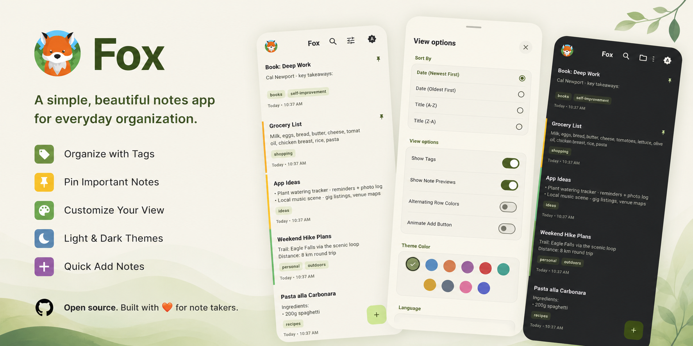

<picture>
  <source media="(prefers-color-scheme: dark)" srcset="assets/images/github/banner.png">
  
</picture>

<p align="center">
  <a href="LICENSE"></a>
  
  
</p>

<p align="center">
  <a href="https://play.google.com/store/apps/details?id=com.teamsuperpanda.fox"></a>
  <a href="https://apps.apple.com/app/fox-list/id1625597940"></a>
</p>

**Free, open-source, local-first notes. No account. No cloud. No internet permission.**

Fox is a notes app with rich text, folders, search, dark mode and 31 languages. Your notes live on your device and the release build requests no internet permission, so there is nothing to sign in to and nothing to sync. The source is on [GitHub](https://github.com/teamsuperpanda/fox) under the MIT licence.

Built by [Team Super Panda](https://www.teamsuperpanda.com).

---

## What it does

Fox is what happens when you strip a notes app down to what actually matters: writing, organising, and finding things fast.

- **Rich text**: bold, italic, bullet lists, ordered lists, note colours. No markdown syntax to remember.
- **Folders and tags**: pin, tag and file notes, then filter the list by folder.
- **Search**: find any note in seconds, even with hundreds of them.
- **Dark mode**: light and dark themes with ten accent colours.
- **31 languages**: English plus 30 translations, with a searchable language picker.
- **Offline-first**: it's a local app that happens to have an editor. Your notes live on your device, always available, no signal required.
- **No accounts**: download it and start typing. There is no signup screen.
- **No internet permission**: the release manifest does not request `android.permission.INTERNET`. The debug and profile builds add it for the Flutter tool, but the shipped app cannot reach the network.

---

## Tech

Fox is a Flutter app with a deliberately simple stack:

| Layer | Choice |
|---|---|
| UI | Flutter with Provider |
| Storage | Hive (local, no server) |
| Editor | Flutter Quill |
| Fonts | Inter (bundled, no network calls) |

No backend. No sync. No analytics. No app data leaves your device.

---

## Run it

```bash
git clone https://github.com/teamsuperpanda/fox.git
cd fox
flutter pub get
flutter run
```

### Tests

```bash
flutter test --coverage
```

---

## License

Fox is free and open source. The code is [MIT licensed](LICENSE), so you can read it, build it and fork it, including commercially. The source lives at [github.com/teamsuperpanda/fox](https://github.com/teamsuperpanda/fox).

The Fox name, logo and brand assets are proprietary and are not covered by the MIT licence (see [ASSETS-LICENSE.md](ASSETS-LICENSE.md)).
